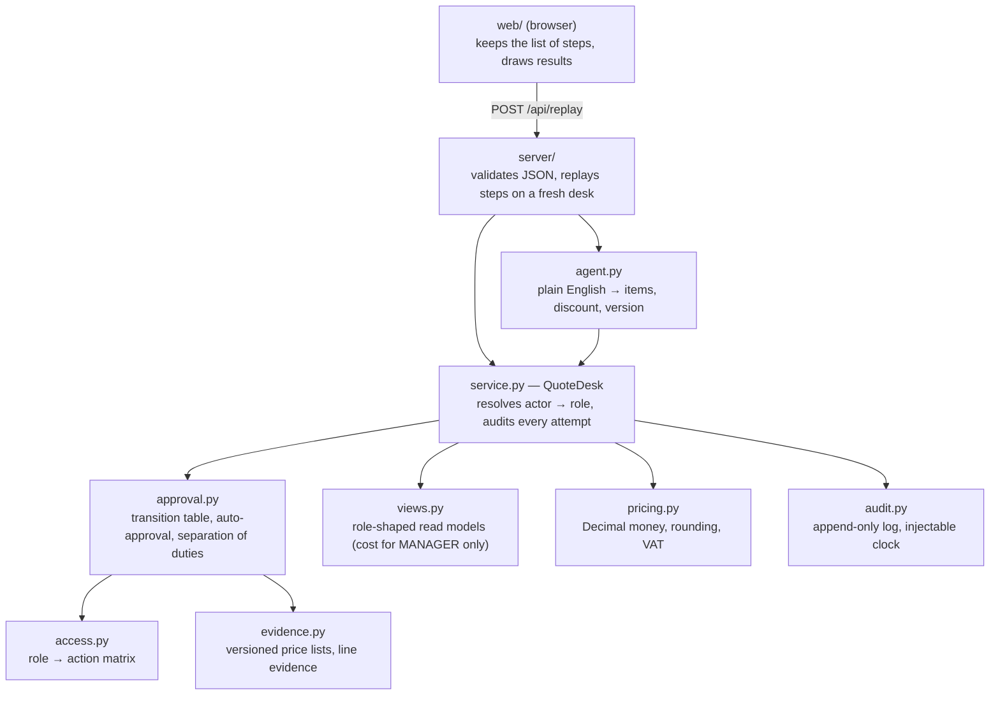

# quote-sim — project overview

A learning project that simulates an AI-agent-assisted sales-quote workflow. A rule-based
"agent" drafts quotes from plain-English requests; humans control access and approval; every
price on a quote points at the versioned price list it came from; every attempt, including
denied ones, is written to an append-only audit log. All data is fake, and no LLM or external
API is called.

## Repository layout

```
.github/workflows/  CI: data check + pytest on Python 3.11–3.14
data/               fake price lists (v1–v3), users, internal cost sheet
docs/               this overview, the workflow map, deployment notes
quote_sim/          the domain library (no web code)
server/             standard-library HTTP server: JSON API + static files
tests/              pytest suite, one file per module
tools/              maintenance scripts (python -m tools.check_data)
web/                the browser page: index.html, app.js, styles.css (no build step)
CLAUDE.md           the project brief and phase plan used with the AI assistant
README.md           problem, decisions, how to run, test results
```

## Architecture

Dependencies only point downwards: `web` knows nothing about Python, `server` translates HTTP
to library calls, and `quote_sim` knows nothing about HTTP.



### What happens on one click

1. The browser appends a step, for example `{"action": "approve", "actor": "manager-01",
   "quote_id": "Q-0001"}`, to its list and sends the whole list.
2. The server builds a new, empty `QuoteDesk` and replays every step in order. A refused step
   (wrong role, wrong state) is recorded in the audit log and the replay continues.
3. Quotes are read back through `QuoteDesk.view()` as the chosen user, so a VIEWER never receives
   cost or margin, and those reads are audited too.
4. If a step cannot be understood (an unknown product, or a discount such as `0.3` that could
   mean 0.3% or 30%), the server answers HTTP 422 with a question. Nothing is kept or audited
   until the person answers.

Because nothing is stored on the server, visitors cannot see each other's quotes, and the same
steps always produce the same audit log.

## Module map

| Module | Responsibility |
|---|---|
| `quote_sim/models.py` | Frozen dataclasses: `Quote`, `LineItem`, `LineEvidence`, policies, `QuoteState` |
| `quote_sim/pricing.py` | Line totals, subtotal, VAT; USD cents with `ROUND_HALF_UP`; input validation |
| `quote_sim/access.py` | Permission matrix as data; `check_permission`, `is_allowed` |
| `quote_sim/approval.py` | Explicit transition table; auto-approval policy; manager decisions |
| `quote_sim/evidence.py` | Loading and publishing price-list versions; attaching and validating evidence |
| `quote_sim/audit.py` | Append-only audit log with frozen entries and an injectable clock |
| `quote_sim/users.py` | Fake user directory; unknown actors are denied |
| `quote_sim/costs.py` | Internal cost sheet, kept apart from price lists |
| `quote_sim/views.py` | Read models shaped per role; the one place cost/margin visibility is decided |
| `quote_sim/service.py` | `QuoteDesk`: the single entry point for every action |
| `quote_sim/interpret.py` | Reading typed discounts; asking when a value is ambiguous |
| `quote_sim/agent.py` | Rule-based drafting agent: parse, match products, choose and explain discounts |
| `quote_sim/config.py` | Illustrative demo values and data paths (not business rules) |
| `quote_sim/demo_data.py` | Builds the demo desk and agent from `config.py` for both demos |
| `quote_sim/demo.py` | Terminal demo: `python -m quote_sim.demo` |
| `server/scenario.py` | Step validation and stateless replay |
| `server/serialize.py` | JSON shapes; money leaves the server as strings |
| `server/app.py` | Routes, request limits, security headers |
| `tools/check_data.py` | Checks `data/` files: versions, users per role, costs for sold products |

## Status

- Phases 0–6 of the original plan are complete.
- Extension steps after the plan:
  1. Users, cost sheet, role-shaped views, `QuoteDesk`, rule-based agent.
  2. Browser simulator (`server/` + `web/`), plain-English agent requests, discount
     clarification.
  3. Repository tidy-up: `tools/check_data.py`, CI, this overview, terminal demo rebuilt on
     `QuoteDesk`.
- Test counts per file are listed in the [README](../README.md#test-results).

## Open questions (pending engineer review)

These are deliberately undecided. The code denies or flags them rather than guessing.

- **Who may revise a rejected quote, or edit an approved one?** Both paths exist in the
  transition table but every role is currently denied, and each attempt is audited.
- **Who may publish a new price-list version?** Today it is a file added to `data/` and listed in
  `config.py`; there is no publishing role.
- **Should a customer-requested discount replace the volume rule?** The agent currently uses the
  customer's figure as stated and writes the volume-rule figure in its note for the approver.
- **Should reads be audited?** They are, with whether cost and margin were visible.
- **Should a request the agent could not understand be audited?** It is not: nothing was attempted
  on a quote. The browser shows the question instead.

## Limitations

- In-memory only; no accounts; no real quote delivery. The web server is a learning demo, not a
  production service, and must never receive real customer or pricing data.
- The agent understands a small, fixed vocabulary of English phrasing. It asks rather than guesses,
  so unusual wording leads to a question, not a wrong quote.
- Published price-list files are not protected against being edited in place; the rule "a
  published version never changes" is enforced in memory and by review, not by the file system.

## Workflow and deployment

- Workflow map and table: [workflow.md](workflow.md) (DRAFT – pending engineer review).
- Hosting the browser demo: [deployment.md](deployment.md).
