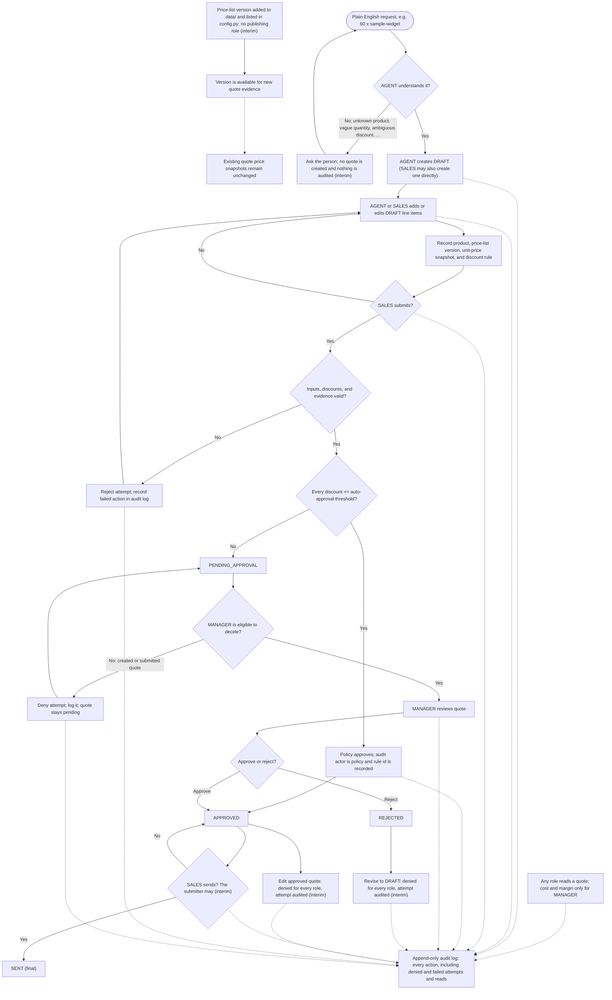

# Quote workflow

**DRAFT – pending engineer review**

This map describes what the code does today. An engineer has not reviewed it yet. Where the brief
left a question open, the project owner has kept the current behaviour as an **interim decision**
(2026-11-15); those points are marked *interim* below and listed at the end. They are not engineer
answers and may change after review.

Every action goes through `QuoteDesk` (`quote_sim/service.py`), which looks up the actor's role in
the fake user directory (unknown actors are denied) and writes every attempt to the audit log.

## Flow

## Workflow details

| Step | Actor | Data accessed | Human approval needed? | Evidence recorded | Failure modes |
|---|---|---|---|---|---|
| Publish a price-list version | No role (interim): a file in `data/` listed in `config.py` | Fake product prices and version identifier | Not specified | Versioned price-list file | Invalid price-list data (caught by `python -m tools.check_data`); files are not protected against in-place edits |
| Draft from a plain-English request | AGENT | Request text, product names and aliases, volume discount rules; no cost or margin | No | Agent note per line: why that discount was chosen; a requested discount is used as stated (within the maximum) and the volume-rule figure is noted for the approver (interim) | Request not understood: the person is asked, nothing is created or audited (interim) |
| Create a quote | AGENT or SALES | Quote inputs and available product prices | No | Quote id and initial state | Permission denied; unknown actor |
| Add or edit DRAFT line items | AGENT or SALES | Product, quantity, discount, and price-list version; no cost or margin | No | Product id, price-list version, unit-price snapshot, and discount rule applied | Invalid quantity, unknown product, discount above the maximum, ambiguous discount (asked, not guessed), or invalid transition |
| Submit for approval | SALES | Quote lines, discount limits, and each line's price evidence | No, if policy auto-approves; otherwise MANAGER review follows | Submission attempt and validation result | Permission denied; invalid transition; missing or invalid evidence; discount above the maximum |
| Auto-approve eligible quote | Policy | Validated line discounts and the auto-approval threshold | No | Approval audit entry with actor `policy` and rule id | Quote fails validation or does not meet threshold |
| Review pending quote | MANAGER | Quote and its evidence; cost and margin may be viewed | Yes | Approval or rejection decision in audit log | Manager created or submitted the quote; invalid transition; permission denied |
| Revise rejected quote | None (interim): every role is denied | Rejected quote | Would be needed again on resubmission | Denied attempt in audit log | Always denied until an authority is decided |
| Send approved quote | SALES, including the submitter (interim) | Approved quote content | Approval has already occurred, by a MANAGER or by policy | Send action in audit log | Permission denied; invalid transition |
| Edit an APPROVED quote | None (interim): every role is denied | Approved quote | Would clear the approval; the quote would need approval again | Denied attempt in audit log; price-list choice for edited lines is undecided | Always denied until an editor is decided |
| Read a quote | AGENT, SALES, MANAGER, or VIEWER | Quote fields allowed for the role; cost/margin only for MANAGER | No | Read entry in audit log, including whether cost and margin were visible (interim) | Unknown actor or unknown quote id |
| Read the audit log | Library: whoever holds the desk gets read-only copies. Browser demo: every role sees the whole log (interim) | All audit entries, including reasons for denials | No | None | None; entries cannot be modified or deleted |
| Record an action | System audit facility | Actor id and role, action, quote id, state change, details, and timestamp | No | Append-only audit record; denied and failed attempts are included | Audit write failure must be surfaced; records have no modify/delete API |

## State and role notes

- Allowed state changes are `DRAFT -> PENDING_APPROVAL`, `PENDING_APPROVAL -> APPROVED |
  REJECTED`, `REJECTED -> DRAFT`, and `APPROVED -> SENT`. Any other transition is invalid.
- `REJECTED -> DRAFT` (revise) and editing an `APPROVED` quote exist in the transition table, but
  no role may use them yet (interim), so a rejected quote cannot currently be reworked.
- `SENT` is final: no edits or further transitions.
- AGENT and SALES cannot see cost or margin. VIEWER is read-only and cannot see cost or margin.
- SALES may submit and send, but cannot approve. MANAGER may approve or reject but cannot decide a
  quote they created or submitted.
- With auto-approval, one SALES user can submit and send a quote with no second person involved
  (interim). Only the policy threshold stands between drafting and the customer.
- Every action, including denied or failed attempts and reads, is recorded in the append-only
  audit log.
- Existing quote price snapshots do not change when a new price-list version is published.

## Interim decisions (pending engineer review)

The engineer was not available. On 2026-11-15 the project owner kept the current behaviour for
all nine open questions. Each question, the current behaviour, and the tests that pin it are in
[PROJECT.md](PROJECT.md#open-questions-pending-engineer-review).

1. Revise a rejected quote: denied for every role.
2. Edit an approved quote: denied for every role; price-list choice for edited lines undecided.
3. Publish a price-list version: no role; a file plus a `config.py` entry.
4. Send: any SALES user, including the submitter.
5. Customer-requested discount: used as stated (within the maximum); the volume-rule figure is
   noted for the approver.
6. Maximum discount, auto-approval threshold, VAT: illustrative demo values only (30%, 10%, 10%).
7. Reading a quote: audited, with cost/margin visibility.
8. A request the agent did not understand: not audited; the person is asked.
9. Reading the audit log: read-only copies to the caller; every role in the browser demo.
