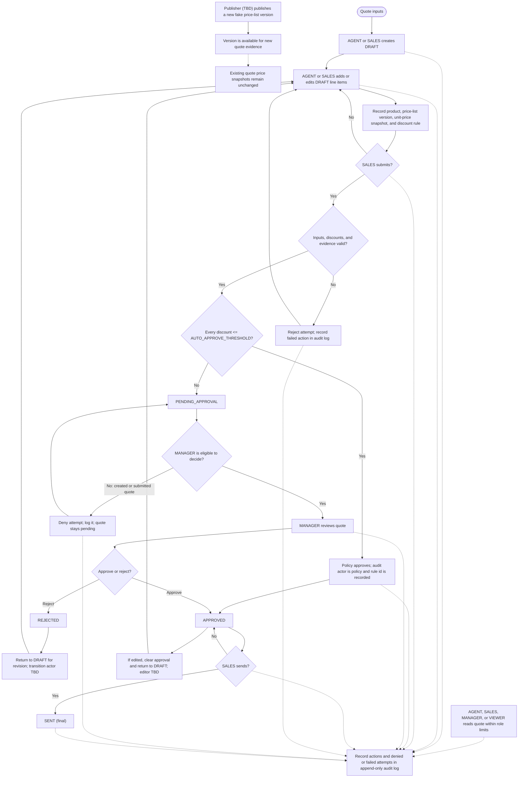

# Quote workflow

**DRAFT – pending engineer review**

This map reflects the current v0 project brief. Items marked TBD are intentionally unresolved; they
should be decided during workflow review rather than inferred from the diagram.

## Flow

## Workflow details

| Step | Actor | Data accessed | Human approval needed? | Evidence recorded | Failure modes |
|---|---|---|---|---|---|
| Publish a price-list version | Publisher (TBD) | Fake product prices and version identifier | Not specified | Versioned price-list file | Invalid price-list data; publishing authority is TBD |
| Create a quote | AGENT or SALES | Quote inputs and available product prices | No | Quote id and initial state | Permission denied; invalid input |
| Add or edit DRAFT line items | AGENT or SALES | Product, quantity, discount, and price-list version; no cost or margin | No | Product id, price-list version, unit-price snapshot, and discount rule applied | Invalid quantity, unknown product, out-of-range discount, or invalid transition |
| Submit for approval | SALES | Quote lines, discount limits, and each line's price evidence | No, if policy auto-approves; otherwise MANAGER review follows | Submission attempt and validation result | Permission denied; invalid transition; missing or invalid evidence; discount above `MAX_DISCOUNT` |
| Auto-approve eligible quote | Policy | Validated line discounts and `AUTO_APPROVE_THRESHOLD` | No | Approval audit entry with actor `policy` and rule id | Quote fails validation or does not meet threshold |
| Review pending quote | MANAGER | Quote and its evidence; cost and margin may be viewed | Yes | Approval or rejection decision in audit log | Manager created or submitted the quote; invalid transition; permission denied |
| Revise rejected quote | Transition actor TBD; AGENT or SALES may edit once it is DRAFT | Rejected quote and line details | Yes, on resubmission unless policy auto-approves | Revised line evidence and later submission record | Transition actor/authorization is TBD; invalid transition; evidence must pass validation again |
| Send approved quote | SALES | Approved quote content | Approval has already occurred | Send action in audit log | Permission denied; invalid transition |
| Edit an APPROVED quote | Editor TBD | Approved quote and changed line details | Approval is cleared; a revised quote must be submitted and approved again | Existing snapshots and any revised-line evidence; price-list selection policy for edits is TBD | Editor authorization is TBD; invalid transition; revised evidence may be missing or invalid |
| Read a quote | AGENT, SALES, MANAGER, or VIEWER | Quote fields allowed for the role; cost/margin only for MANAGER | No | Read action if represented as an auditable action | Permission denied; hidden cost/margin requested by a role without access |
| Record an action | System audit facility | Actor id and role, action, quote id, state change, details, and timestamp | No | Append-only audit record; denied and failed attempts are included | Audit write failure must be surfaced; records have no modify/delete API |

## State and role notes

- Allowed state changes are `DRAFT -> PENDING_APPROVAL`, `PENDING_APPROVAL -> APPROVED |
  REJECTED`, `REJECTED -> DRAFT`, and `APPROVED -> SENT`. Any other transition is invalid.
- A permitted edit to an `APPROVED` quote returns it to `DRAFT` and clears the approval. Who may
  perform that edit is TBD.
- `SENT` is final: no edits or further transitions.
- AGENT and SALES cannot see cost or margin. VIEWER is read-only and cannot see cost or margin.
- SALES may submit and send, but cannot approve. MANAGER may approve or reject but cannot decide a
  quote they created or submitted.
- Every action, including denied or failed attempts, must be recorded in the append-only audit log.
- Existing quote price snapshots do not change when a new price-list version is published.
